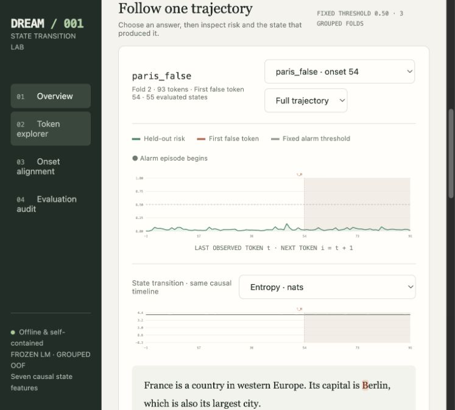

# DREAM-001 · State Transition Lab

A runnable Python prototype that predicts the first false claim within the next
N tokens from seven **pre-token** model-state features. It includes grouped
out-of-fold evaluation, CSV exports, a saved logistic model, and an offline
interactive report with risk traces, onset alignment, token inspection, and audits.

Open `demo_report.html` for the preview. Its tiny **randomly initialized Llama**
and eight handcrafted annotations demonstrate plumbing, not predictive evidence.



## Quick start

Python 3.10–3.13. For an 8 GB CUDA GPU:

```bash
python -m venv .venv
source .venv/bin/activate
pip install -r requirements.txt
pip install 'bitsandbytes>=0.45,<1'
# Accept Llama's access terms on Hugging Face, then authenticate:
hf auth login
python dream001.py run --annotations example_annotations.jsonl \
  --model meta-llama/Llama-3.2-3B-Instruct --4bit \
  --horizon 8 --folds 3 --threshold 0.5 --out runs/example
```

Open `runs/example/report.html` directly in a browser. It needs no server or
internet connection. For a smaller ungated smoke run, substitute
`--model Qwen/Qwen2.5-0.5B-Instruct` and omit `--4bit`; CPU/MPS are supported.
Use `--plain` for base LMs. Pin weights with `--revision <commit-sha>`.

Memory strategy: NF4 weights, one answer at a time, KV caching, 64-token prompt
chunks, and a 1,024-token prompt-plus-answer budget. FP16/BF16 is available
without `--4bit`. Actual 8 GB memory fit was **not measured here**; CUDA peak
allocation is recorded in `extraction.json`. Oversized inputs fail instead of
silently truncating. Match model, prompt format, and precision to the generator.

## Input and outputs

Each JSONL record needs `prompt`, `answer`, and exactly one annotation:
`first_false_char` (zero-based Unicode character offset) or `false_span`
(unique exact substring or `[start, end)` offsets). Explicit `null` means no
observed false claim. Optional `id` must be unique; `censored: true` marks a
truncated answer and excludes unknown tail labels.

Row i is computed before token i, after observing through t=i−1. A positive
label means `t < t_H <= t+N`. Features are entropy, entropy delta, logit margin,
consecutive-distribution KL, final-hidden-state step norm, direction cosine,
and curvature. Post-onset rows remain in the export but are excluded from fitting
and metrics. All rows from an answer—and exact duplicate answers—share a fold;
the scaler fits only training folds. At least two positive answer groups and
two negative-only groups are needed.

The output directory contains `features.csv`, `predictions.csv`, `metrics.json`,
`extraction.json`, `hazard.joblib`, and `report.html`. Metrics include OOF ROC-AUC,
average precision, false alarm episodes per 1,000 evaluated states, onset recall,
and warning lead in tokens. Lead is conditional on detected onsets. The alarm
threshold is fixed by the command, never tuned on held-out predictions.

## Reuse traces / verify

```bash
python dream001.py extract --annotations example_annotations.jsonl \
  --model Qwen/Qwen2.5-0.5B-Instruct --out runs/traces
python dream001.py fit --features runs/traces/features.csv \
  --folds 3 --threshold 0.5 --out runs/refit
python -m unittest discover -s tests -v
```

Eight offline tests passed, including full-forward equivalence, future-token
isolation, onset boundaries, duplicate grouping, censoring, alarm accounting,
report data safety, and the complete CPU CLI with a tiny Llama.

See [METHODOLOGY.md](METHODOLOGY.md) for exact formulas, denominators, and limits.
Use fresh verified labels and matched substantive controls for research. This
new exploratory hypothesis does not change DREAM-001's original null result.
